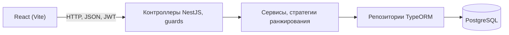
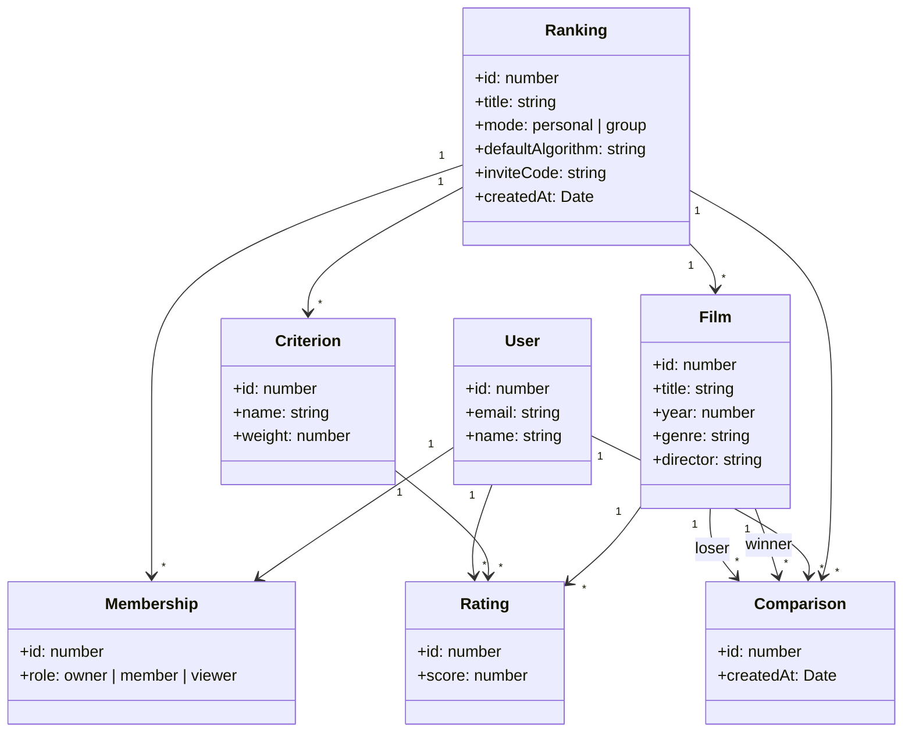
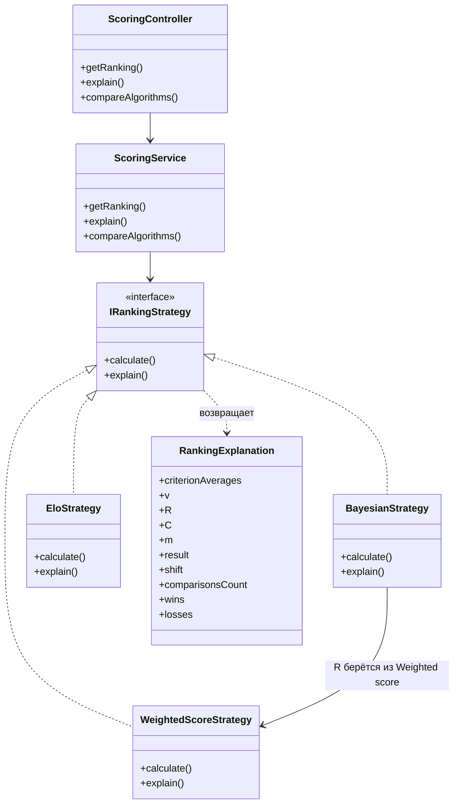

# Архитектура

Веб-приложение: клиент на React и REST API на NestJS, данные в PostgreSQL (схема в [database.md](database.md)).



## Структура backend

```
backend/src/
  auth/          регистрация, вход, JWT, лимит попыток входа
  users/         пользователи
  rankings/      пространства, режимы, код-приглашение
  memberships/   участники и роли, guard по роли
  films/         фильмы
  criteria/      критерии оценки
  ratings/       оценки
  comparisons/   сравнения для Elo, подбор пары, отмена последнего сравнения
  scoring/       расчёт рейтинга, стратегии, объяснение
  import/        импорт из Excel
  export/        экспорт в CSV и PDF
  database/      миграции и тестовые данные
```

## Структура frontend

```
frontend/src/
  api/          запросы к серверу
  components/   таблицы, формы, переключатели алгоритма и области
  pages/        вход и регистрация, мои пространства, пространство
  types/        типы данных
```

Страница пространства содержит вкладки: Рейтинг, Фильмы, Сравнение, Критерии, Участники. Набор вкладок зависит от роли: наблюдателю доступен только Рейтинг, участнику - всё кроме Критериев и Участников. Настройки пространства открываются из заголовка страницы и доступны только владельцу. Вход по коду-приглашению находится на странице «Мои пространства».

## Доступ и права

- Вход по email и паролю выдаёт JWT со сроком жизни 7 дней, refresh-токена нет: по истечении нужен повторный вход. Лимит 5 попыток в минуту действует на вход и на вход по коду-приглашению. Клиент хранит токен в `localStorage` и отправляет в заголовке `Authorization`.
- Каждый запрос к данным пространства проходит два guard: проверка токена и проверка роли пользователя в этом пространстве по таблице `memberships`. Нужные роли указаны у каждой операции в контроллере. Скрытие кнопок в интерфейсе права не заменяет.

## Окружение

- Инструменты разработки: VS Code, Git, npm, Docker.
- Локально: PostgreSQL в Docker, backend и frontend запускаются через npm.
- Адрес базы и секрет для JWT берутся из переменных окружения.
- Render: backend - веб-сервис, frontend - статический сайт, база - управляемый Postgres.

## Диаграмма классов: предметная область



## Диаграмма классов: ранжирование



В `RankingExplanation` для Weighted score и Bayesian заполнены средние по критериям, v, R, C, m, итог и сдвиг, для Elo - число сравнений, победы, поражения и итог.

## Расчёт рейтинга

1. Пользователь выбирает алгоритм, область и фильтры, интерфейс отправляет запрос с токеном.
2. Guard проверяют токен и роль пользователя в пространстве.
3. `ScoringService` проверяет параметры и выбирает стратегию по названию алгоритма, по умолчанию берётся алгоритм пространства.
4. Сервис читает данные пространства через репозитории: оценки с критериями для Weighted score и Bayesian, сравнения для Elo. При области «Только я» данные пользователя отбираются здесь, до расчёта.
5. Стратегия получает данные от сервиса и считает рейтинг всех фильмов. К БД она не обращается.
6. Сервис для Weighted score и Bayesian считает разброс, затем применяет фильтр по жанру и году, округляет рейтинг, расставляет места и сортирует. Фильтр применяется после расчёта, поэтому C в Bayesian и рейтинги Elo от фильтра не зависят. Экспорт использует тот же сервис расчёта, поэтому файл совпадает с таблицей на экране.

## Ошибки и граничные случаи

| Ситуация | Что делает программа |
|----------|----------------------|
| Нет токена или он недействителен | Отклоняет запрос, клиент отправляет на страницу входа |
| Роль не позволяет операцию | Отклоняет запрос, данные не меняются |
| Пространство, фильм или критерий не найдены, пользователь не участник пространства | Сообщает, что ничего не найдено |
| Email, фильм, критерий уже существует | Сообщает о дубликате, запись не создаёт |
| Пустое обязательное поле, балл вне диапазона 1-10, неверный файл импорта | Не сохраняет данные, показывает ошибку у поля. Неверный файл отклоняет целиком, в верном файле пропускает некорректные строки и показывает их в отчёте |
| Параметры m, K или начальный рейтинг недопустимы | Отклоняет расчёт, сообщает, какой параметр неверен |
| Меньше двух фильмов для сравнения | Сообщает, что нужно минимум два |
| Пустая таблица при экспорте | Сообщает, что экспортировать нечего |

Фильм без оценок показывается в конце таблицы без рейтинга, пространство без критериев даёт пустую таблицу Weighted score и Bayesian - это не ошибки. Деления на ноль не возникает: расчёт идёт только по фильмам с оценками, а вес критерия всегда больше нуля.
