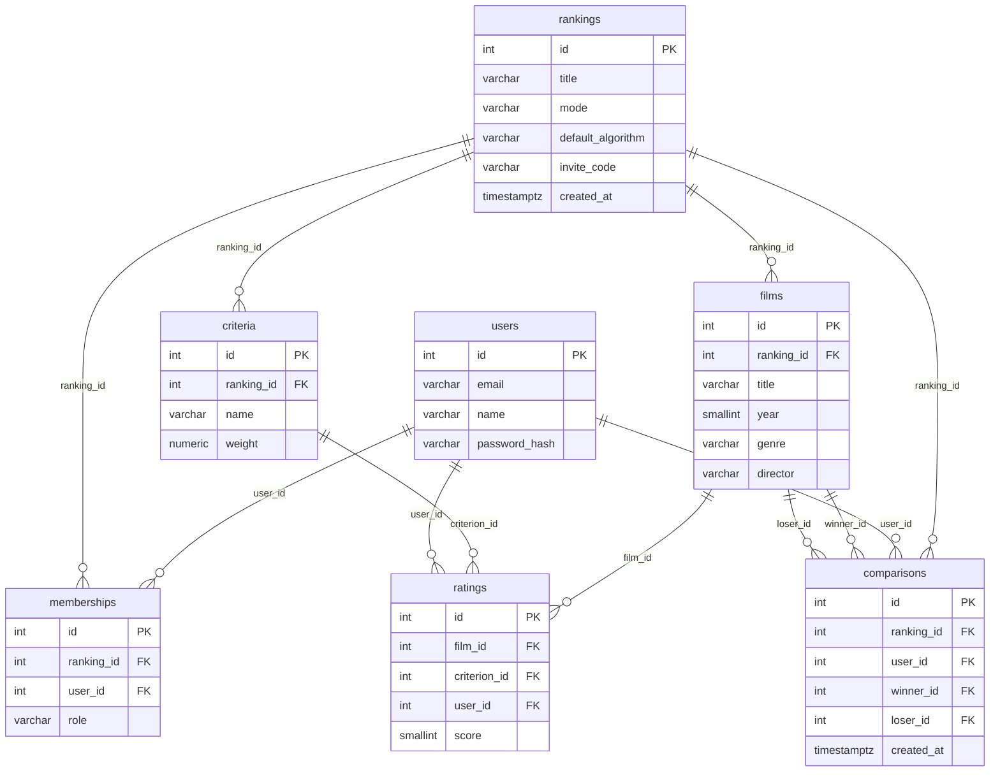

# Схема базы данных

СУБД: PostgreSQL. Схема создаётся миграциями TypeORM.

Пространство в приложении - таблица `rankings`.

## users

| Поле | Тип | Ограничения |
|------|-----|-------------|
| id | integer | PK, автоинкремент |
| email | varchar(255) | NOT NULL, UNIQUE, хранится в нижнем регистре |
| name | varchar(100) | NOT NULL |
| password_hash | varchar(60) | NOT NULL, хеш bcrypt |

## rankings

| Поле | Тип | Ограничения |
|------|-----|-------------|
| id | integer | PK, автоинкремент |
| title | varchar(100) | NOT NULL |
| mode | varchar(10) | NOT NULL, CHECK: personal или group |
| default_algorithm | varchar(20) | NOT NULL, CHECK: weighted, bayesian или elo |
| invite_code | varchar(8) | NOT NULL, UNIQUE |
| created_at | timestamptz | NOT NULL, по умолчанию now() |

## memberships

| Поле | Тип | Ограничения |
|------|-----|-------------|
| id | integer | PK, автоинкремент |
| ranking_id | integer | NOT NULL, FK → rankings(id) ON DELETE CASCADE |
| user_id | integer | NOT NULL, FK → users(id) |
| role | varchar(10) | NOT NULL, CHECK: owner, member или viewer |

Пара (ranking_id, user_id) уникальна.

## films

| Поле | Тип | Ограничения |
|------|-----|-------------|
| id | integer | PK, автоинкремент |
| ranking_id | integer | NOT NULL, FK → rankings(id) ON DELETE CASCADE |
| title | varchar(255) | NOT NULL |
| year | smallint | NOT NULL, не меньше 1888 |
| genre | varchar(100) | NOT NULL |
| director | varchar(255) | NOT NULL |

Тройка (ranking_id, title, year) уникальна. Верхнюю границу года из ТЗ проверяет приложение.

## criteria

| Поле | Тип | Ограничения |
|------|-----|-------------|
| id | integer | PK, автоинкремент |
| ranking_id | integer | NOT NULL, FK → rankings(id) ON DELETE CASCADE |
| name | varchar(100) | NOT NULL |
| weight | numeric(5,2) | NOT NULL, больше 0 |

Пара (ranking_id, name) уникальна.

## ratings

| Поле | Тип | Ограничения |
|------|-----|-------------|
| id | integer | PK, автоинкремент |
| film_id | integer | NOT NULL, FK → films(id) ON DELETE CASCADE |
| criterion_id | integer | NOT NULL, FK → criteria(id) ON DELETE CASCADE |
| user_id | integer | NOT NULL, FK → users(id) |
| score | smallint | NOT NULL, от 1 до 10 |

Тройка (film_id, criterion_id, user_id) уникальна.

## comparisons

| Поле | Тип | Ограничения |
|------|-----|-------------|
| id | integer | PK, автоинкремент |
| ranking_id | integer | NOT NULL, FK → rankings(id) ON DELETE CASCADE |
| user_id | integer | NOT NULL, FK → users(id) |
| winner_id | integer | NOT NULL, FK → films(id) ON DELETE CASCADE |
| loser_id | integer | NOT NULL, FK → films(id) ON DELETE CASCADE |
| created_at | timestamptz | NOT NULL, по умолчанию now() |

winner_id не равен loser_id.

## Правила на уровне приложения

- Владелец создаётся вместе с пространством. Не больше одного владельца гарантирует индекс в базе, а то, что владелец есть всегда, обеспечивает приложение: его нельзя убрать, роль не меняется.
- Оценки и сравнения может создавать только пользователь с ролью владельца или участника. Фильм, критерий и оба фильма сравнения принадлежат тому же пространству.
- При удалении участника его оценки и сравнения в этом пространстве удаляются в одной транзакции вместе с записью об участии.

## Индексы

| Поле | Причина |
|------|---------|
| memberships.user_id | Список пространств пользователя |
| comparisons (ranking_id, created_at) | Выборка сравнений пространства в порядке создания для Elo |
| memberships (ranking_id), уникальный, WHERE role = 'owner' | Не больше одного владельца в пространстве |

Остальные запросы идут по индексам уникальных ограничений. Под прочие внешние ключи индексы не нужны, данных немного.

## Что не хранится

- Рейтинг Elo. Он считается по сравнениям пространства в порядке создания.
- Параметры алгоритмов (m, K, начальный рейтинг Elo). Они передаются при расчёте, значения по умолчанию лежат в константах.
